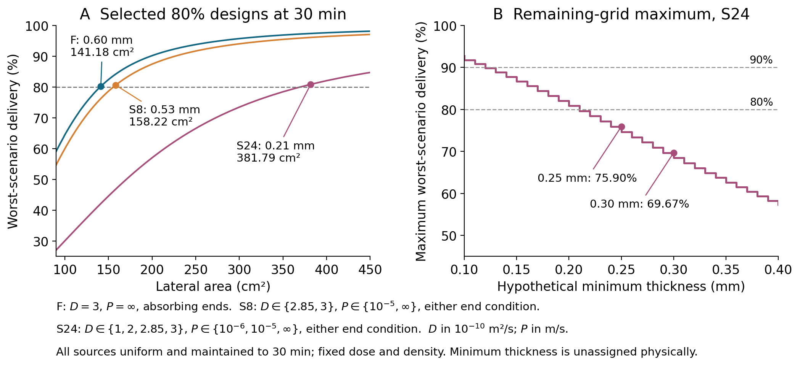
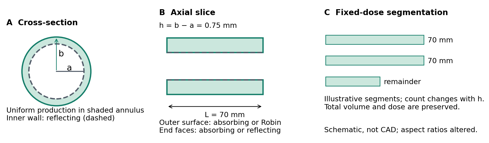

# Early insulin delivery at fixed dose

**Revision 3 · Computational research candidate · Repository release**

How much insulin crosses a proposed human-scale islet implant boundary in the first 30 minutes—and what must change to deliver more while preserving the cell dose?

This study models the proposed seven-pouch BEAM geometry, checks its transport calculation with two numerical methods, and maps the design consequences of stated diffusion and boundary assumptions. Its contribution is a device-specific design analysis; the results remain conditional on the model.

**[Read the paper](manuscript/paper.pdf)** · **[Editable Word](manuscript/paper.docx)** · **[Final review notes](REVIEW_NOTES.md)**



## What the calculation shows

| Question | Result under the stated assumptions |
|---|---|
| How much is delivered by 30 minutes in the nominal uniform-source model? | **71.53%** of production during that interval. |
| What meets the 80% target in the favorable sampled design family? | **0.60 mm** layer; **141.18 cm²** lateral area. Its margin is small. |
| What meets 80% across the declared 24 scenarios? | **0.21 mm** layer; **381.79 cm²** lateral area, with 24 pouch segments. |
| Across the 24 scenarios, what if the permitted layer must be at least 0.25 or 0.30 mm? | The best worst-scenario delivery is **75.90% or 69.67%**. No remaining sampled design meets 80%. |

Minimum permitted thickness is an **unassigned physical constraint**, not a measured biological cutoff. Scenario sets have no assigned probabilities. Lateral area, pouch count and active footprint are different measures; none includes all implant-system overhead.

## Which transport assumptions change the design cost?

Each row independently reoptimizes the same fixed-dose grid for **80% delivery by 30 minutes**. These costs are nonadditive.

| Transport scenario | Selected layer | Lateral area |
|---|---:|---:|
| Favorable: D = 3 × 10⁻¹⁰ m²/s, perfect outer sink, absorbing ends | 0.60 mm | 141.18 cm² |
| Lower diffusivity only: D = 1 × 10⁻¹⁰ m²/s | 0.34 mm | 240.09 cm² |
| Finite outer permeability only: P = 1 × 10⁻⁶ m/s | 0.28 mm | 289.12 cm² |
| Reflecting ends only | 0.59 mm | 143.36 cm² |
| All three changes | 0.21 mm | 381.79 cm² |

End reflection changes the pass/fail outcome of the narrowly passing 0.60 mm design, yet reoptimization needs only **1.55%** more area than the favorable redesign. The selected diffusivity and permeability changes have much larger costs. This comparison does not identify which mechanism dominates an actual device.

## A short path through the evidence

1. **[Manuscript](manuscript/paper.pdf)** — question, model, results and limitations.
2. **[Methods](code/METHODS.md)** — equations, numerical verification and selection rules.
3. **[Final hostile-review notes](REVIEW_NOTES.md)** — findings, repairs and checks.
4. **[Data and provenance](#data-and-provenance)** — inspect the numbers and their sources.
5. **[Reproduce the results](#reproduce-the-results)** — verify the supplied release, then rebuild separately.

<details>
<summary><strong>Model geometry</strong></summary>



The family preserves 420,000 islet equivalents, effective loading density and outer radius. It varies layer thickness and uses actual finite segments no longer than 70 mm. The supplied geometry and dose discrepancy is retained in the [geometry ledger](geometry_ledger.csv), without assigning an unsupported physical explanation.

</details>

## Reproduce the results

Use Python with the pinned dependencies. Numerical reproduction requires no network after installation and no private source cache.

```bash
python -m pip install -r requirements.txt
python code/verify_manifest.py
python reproduce.py
```

**Two separate checks:**

- **Supplied-file integrity** verifies the original manifest, sizes and SHA-256 hashes exactly, before calculation.
- **Numerical reproduction** rebuilds in a new `_reproduced/` directory, compares floating-point results under the explicit [comparison contract](reproduction_comparison_specification.json), and requires exact agreement on identities, selected designs and decision predicates. It preserves the supplied files and records actual generated values and their hashes.

Regenerated `REPORT.md` and `manuscript/content.json` are compared as strict UTF-8 text with CRLF pairs normalized to LF. Every other character remains significant. Supplied-file hashes still require exact bytes.

Last-bit numerical differences can pass the second check. A changed threshold decision, malformed table, altered scientific specification or beyond-tolerance result cannot. Reproduction tolerances do not enlarge the study's numerical uncertainty or engineering acceptance rules.

To rebuild the Word, TeX and PDF formats as well:

```bash
python -m pip install -r requirements-manuscript.txt
python reproduce.py --manuscript --output _reproduced/review
```

The output directory must not already exist. `--manuscript` also requires `pdflatex` and the packages listed in [the methods](code/METHODS.md). The command prints the generated-output and comparison-report paths. Re-running the supplied-file integrity check still verifies the untouched release.

Reference environment: CPython 3.12.14, NumPy 2.3.5, SciPy 1.17.0, Matplotlib 3.10.8 and MiKTeX/pdfTeX on Windows. [The lockfile](requirements-lock.txt) records dependencies. Numerical equivalence is tested explicitly; byte-identical plots, PDFs and document timestamps are not promised across environments.

**Git file handling:** `.gitattributes` disables text conversion for every release file (`* -text`), preserving frozen bytes even when `core.autocrlf` is enabled. Do not run newline normalization over the scientific specifications or supplied artifacts. Clone the repository, then run the integrity check before reproducing. The regression suite is available with `python code/test_reproduction_contract.py` from the candidate directory.

## Data and provenance

| Inspect | File |
|---|---|
| Complete transport map: 6,552 rows | [robustness_map.csv](data/robustness_map.csv) |
| 273 constrained maxima | [design_constraints_maxima.csv](data/design_constraints_maxima.csv) |
| 546 target decisions | [design_constraints_targets.csv](data/design_constraints_targets.csv) |
| Five mechanism comparisons and Fo/Bi | [mechanism_comparison.csv](data/mechanism_comparison.csv) |
| Baseline numerical verification | [numerical_verification.json](evidence/numerical_verification.json) |
| Independent finite-volume checks | [robustness_verification.json](evidence/robustness_verification.json) |
| Selection evidence | [design_constraints_verification.json](evidence/design_constraints_verification.json) |
| Source acquisition and qualifications | [sources.tsv](sources.tsv) · [source qualification](evidence/source_qualification.md) |
| Closest-literature comparison | [prior_art_review_v2.md](evidence/prior_art_review_v2.md) |
| Proposed held-out validation | [proposed_validation.md](evidence/proposed_validation.md) |
| Original focused revision response | [RESPONSE_TO_REVIEW.md](RESPONSE_TO_REVIEW.md) |
| Supplied-file integrity | [artifact_manifest.json](artifact_manifest.json) |

## Scope of the result

This is a conditional computational study. Device diffusivity, permeability, end accessibility, secretion history and allowable cell-bearing thickness remain uncalibrated for the proposal. No clinical outcome, validated manufacturing choice, continuous uncertainty guarantee or experimental validation follows.

The next useful evidence is independent material and membrane transport measurement, recovery controls and allowable-layer characterization, followed by prediction of a held-out geometry without refitting. The manuscript includes that discrimination plan.

All figures are original. This repository contains the scientific release. Publisher source files, private framework material and historical archives are excluded by `.gitignore`.
